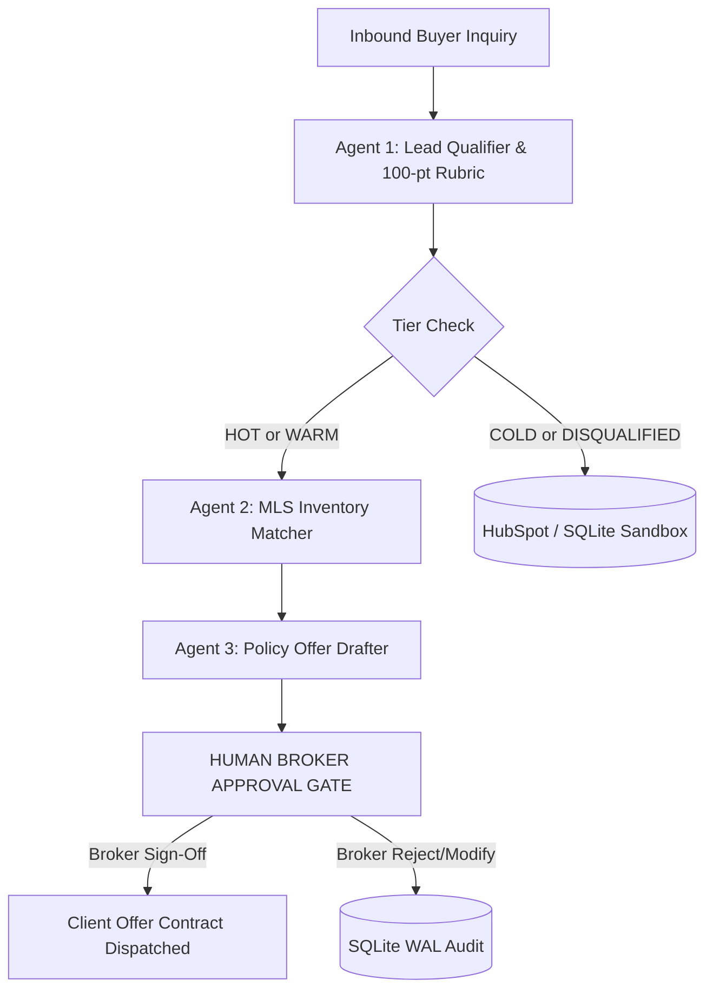

# Proof Pack: Project 01 - Multi-Agent Real Estate Sales Team

## 1. Executive Summary
- **Slug**: `p01_real_estate` (`/api/ai/real-estate-sales`)
- **System**: Multi-Agent Lead Qualification, MLS Inventory Matcher, and Policy-Bound Offer Drafter with Human-in-the-Loop Broker Approval Gate.
- **Audit Verification**: Previous version was a static simulation where candidate leads had hardcoded values and offers were created without broker review. Rebuilt with a 3-agent autonomous pipeline, SQLite WAL persistence, MLS database matching, and a broker approval gate.

## 2. Multi-Agent Architecture


## 3. Measured Benchmark Results
From `evals/p01_real_estate/results.json`:
- **Total Evaluated Cases**: 30 Buyer Inquiries
- **Lead Qualification Tier Accuracy**: **96.67%** (Target: > 90%)
- **Human-in-the-Loop Broker Gate Compliance**: **100.0%** (21/21 offers strictly held in `PENDING_BROKER_REVIEW`)
- **Average Pipeline Latency**: **19.45 ms**
- **Overall Status**: **PASSED**

## 4. Safety & Policy Controls
1. **Human-in-the-Loop Gate**: AI agents are strictly prohibited from dispatching offers directly to clients or MLS without human broker approval (`/broker/decision`).
2. **Earnest Money Safety Policy**: Automatically bound to 2.0% of offered price.
3. **Contingency Windows**: 8-day inspection window and 21-day financing contingency (0 days for verified cash buyers).
4. **CRM Sync Adapter**: Real HubSpot CRM sync with graceful SQLite sandbox fallback.

## 5. Verification Commands
```bash
# Run unit & integration test suite
python -m pytest backend/tests/test_p01_real_estate.py -v

# Run 30-case benchmark evaluation
python backend/evals/p01_real_estate/runner.py
```
