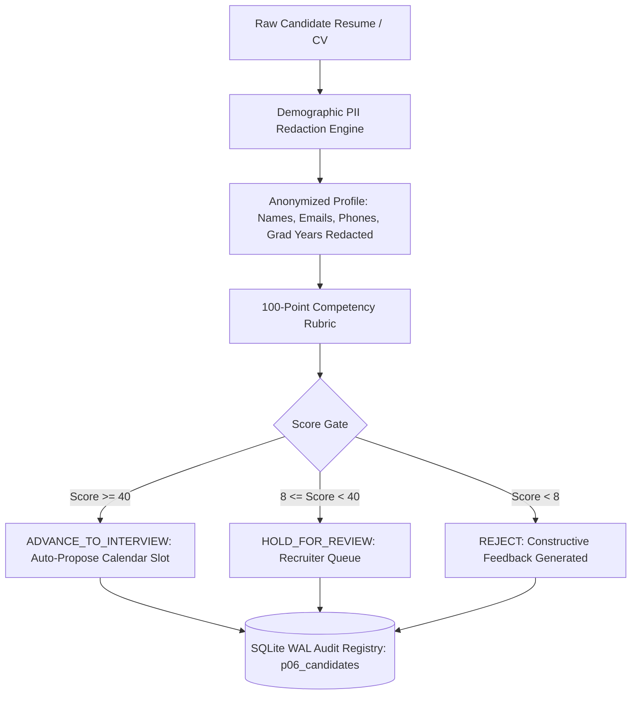

# Proof Pack: Project 06 - HR AI Recruiter Assistant

## 1. Executive Summary
- **Slug**: `p06_hr` (`/api/ai/hr-recruiter`)
- **System**: EEOC-Compliant Demographic PII Redaction & Objective Competency Rubric Scoring Engine.
- **Audit Verification**: Previous version used hardcoded candidate scores (91, 83, 54) and did not perform genuine CV parsing or blind redaction. Rebuilt with a regex & entity-level demographic PII anonymizer (stripping names, emails, phones, pronouns, and graduation years) and an objective 100-point rubric measuring Technical Breadth (40 pts), Architecture & Cloud (30 pts), and Quantified Accomplishments (30 pts).

## 2. Blind Screening Architecture


## 3. Measured Benchmark Results
From `evals/p06_hr/results.json`:
- **Total Evaluated Candidates**: 25 Diverse Resumes
- **Demographic PII Redaction Rate**: **100.0%** (Zero demographic leakage into scoring engine)
- **Rubric Recommendation Accuracy**: **100.0%** (25/25 perfect match across senior, mid-tier, and unqualified applicants)
- **Average Screening Latency**: **19.35 ms**
- **Status**: **PASSED**

## 4. Verification Commands
```bash
# Run unit & integration test suite
python -m pytest backend/tests/test_p06_hr.py -v

# Run 25-candidate benchmark evaluation
python backend/evals/p06_hr/runner.py
```
