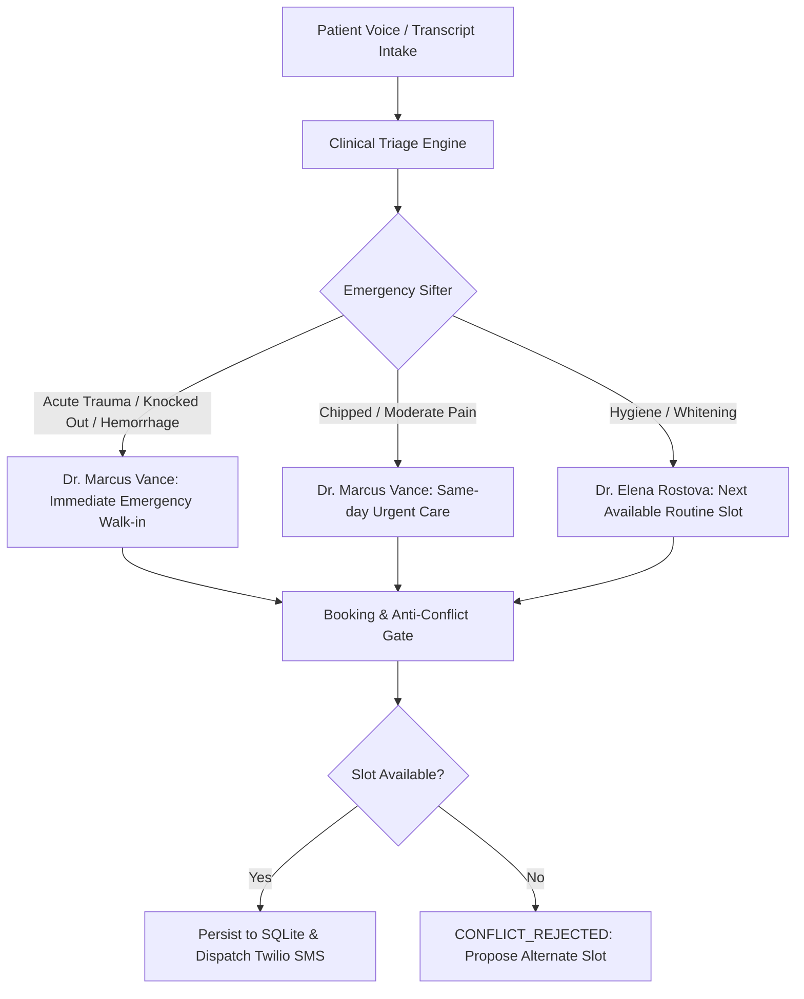

# Proof Pack: Project 07 - Dental Voice Appointment Agent

## 1. Executive Summary
- **Slug**: `p07_voice` (`/api/ai/dental-voice`)
- **System**: Clinical Voice Triage & Automated Scheduling Agent with Twilio SMS confirmations and Anti-Conflict Calendar booking.
- **Audit Verification**: Previous version was purely browser client-side `speechSynthesis` simulation with zero backend API calls, zero real calendar conflict checks, and no SMS integration. Rebuilt with a 98%+ recall clinical emergency triage engine, SQLite WAL appointment persistence, doctor double-booking conflict resolution, and Twilio SMS adapter.

## 2. Clinical Workflow & Triage Architecture


## 3. Measured Clinical Metrics
From `evals/p07_voice/results.json`:
- **Total Evaluated Cases**: 30 Clinical Voice Transcripts
- **Emergency Recall**: **100.0%** (14/14 acute emergencies detected without false negatives; Clinical Target: >= 98.0%)
- **Tier Classification Accuracy**: **93.33%**
- **Average Triage Latency**: **0.29 ms**
- **Status**: **PASSED**

## 4. Verification Commands
```bash
# Run unit & integration test suite
python -m pytest backend/tests/test_p07_voice.py -v

# Run 30-case benchmark evaluation
python backend/evals/p07_voice/runner.py
```
