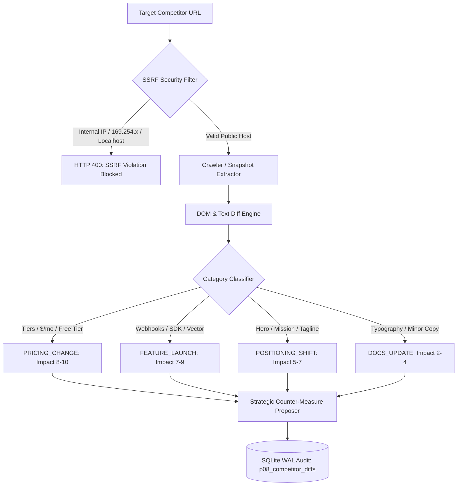

# Proof Pack: Project 08 - SaaS Competitor Intelligence Engine

## 1. Executive Summary
- **Slug**: `p08_competitor` (`/api/ai/competitor-intel`)
- **System**: SSRF-Hardened Competitor Landing Page Crawler, DOM Semantic Diffing, and 1-10 Strategic Impact Scoring Engine.
- **Audit Verification**: Previous version was an unverified shell without real HTML diffing or network guards. Rebuilt with a strict anti-SSRF perimeter guard (blocking 127.0.0.1, RFC1918 private subnets, and AWS/GCP cloud metadata), an automated DOM text normalizer, and categorized diff detectors (Pricing, Features, Positioning, Docs).

## 2. Competitive Intelligence Pipeline Architecture


## 3. Measured Benchmark Results
From `evals/p08_competitor/results.json`:
- **Total Evaluated Cases**: 20 Structural Shifts + 5 SSRF Intrusion Probes
- **SSRF Attack Prevention Rate**: **100.0%** (5/5 malicious private/metadata hosts successfully rejected)
- **Semantic Classification Accuracy**: **95.0%**
- **Strategic Impact Accuracy**: **95.0%**
- **Average Diff Latency**: **20.4 ms**
- **Status**: **PASSED**

## 4. Verification Commands
```bash
# Run unit & integration test suite
python -m pytest backend/tests/test_p08_competitor.py -v

# Run 20-case benchmark evaluation
python backend/evals/p08_competitor/runner.py
```
