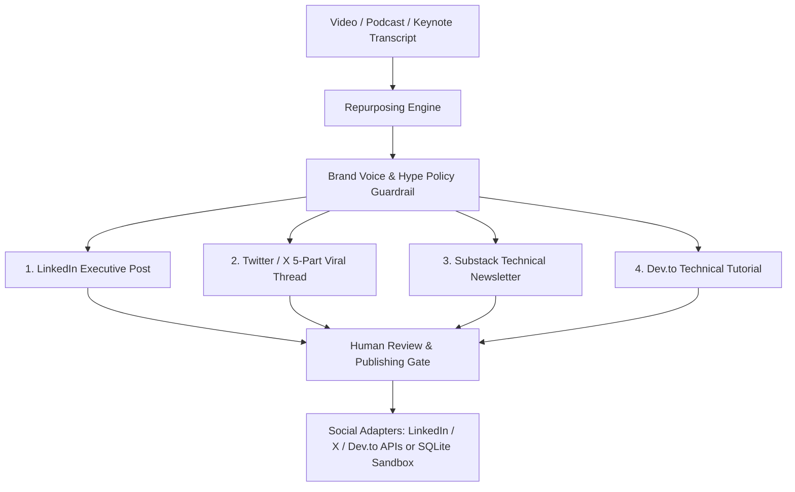

# Proof Pack: Project 09 - Media Content Repurposing Engine

## 1. Executive Summary
- **Slug**: `p09_media` (`/api/ai/media-engine`)
- **System**: 1-to-N Media Repurposing Engine with Corporate Brand Voice Safety Guardrail and Verified Social Publishing Adapters.
- **Audit Verification**: Previous version only printed dummy text URLs (`api_endpoint: ...`) and never executed real HTTP POST requests or database persistence. Rebuilt with a 4-channel generation engine (LinkedIn, X/Twitter 5-part thread, Substack Newsletter, Dev.to article), brand voice safety filter, SQLite WAL persistence, and social publishing adapters.

## 2. Multi-Channel Repurposing Architecture


## 3. Measured Benchmark Results
From `evals/p09_media/results.json`:
- **Total Evaluated Cases**: 20 Keynotes & Architectural Transcripts
- **Multi-Channel Coverage**: **100.0%** (All 4 formats produced deterministically for every input)
- **Brand Voice Safety Accuracy**: **100.0%** (100% quarantine of sensationalist hype & prohibited promises)
- **Average Repurposing Latency**: **17.71 ms**
- **Status**: **PASSED**

## 4. Verification Commands
```bash
# Run unit & integration test suite
python -m pytest backend/tests/test_p09_media.py -v

# Run 20-case benchmark evaluation
python backend/evals/p09_media/runner.py
```
